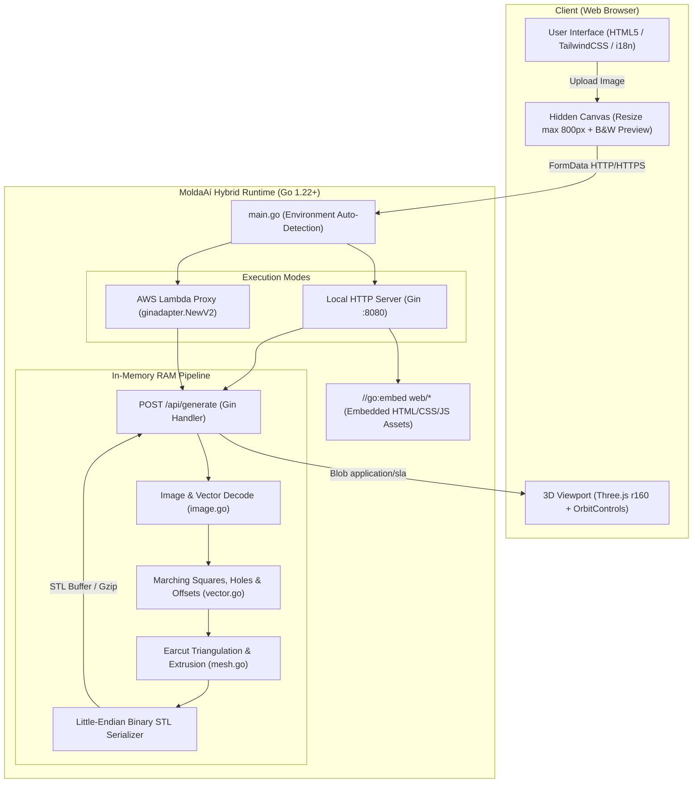

# 01 - Architecture and Software Engineering

**MoldaAí** was designed under the guiding principles of **extreme operational efficiency, zero-maintenance deployments, and near-zero infrastructure cost**.

---

## 1. General Architectural Diagram



---

## 2. Core Architectural Principles

### 2.1 Single-Binary with `//go:embed`
All client-side assets (`web/index.html` and `web/app.js`) are compiled directly into the Go executable binary utilizing standard library packages `embed` and `io/fs.Sub`.
* **Zero disk dependencies:** The executable runs anywhere without requiring external HTML/JS assets on disk.
* **No cloud hosting overhead:** Eliminates the need for S3 buckets, CloudFront distributions, or reverse-proxy Nginx servers for static hosting.
* **Portability:** The binary can be copied and executed as a standalone artifact across any supported target platform.

### 2.2 Gin Web Framework & Dual Runtime (Local & AWS Lambda)
HTTP routing is managed by the high-performance **Gin Web Framework** (`github.com/gin-gonic/gin`), providing fast request parsing, recovery middleware, structured logging, and robust routing standards.

The entrypoint `main.go` inspects the environment variable `AWS_LAMBDA_FUNCTION_NAME`:
* **Local Development / Docker / Dedicated Host:** When the variable is empty, the application initiates an HTTP listener on `:8080` (or `$PORT`) via `router.Run(":" + port)`.
* **AWS Lambda (Serverless):** When running in AWS Lambda, the Gin engine is wrapped by `ginadapter.NewV2(router)` from `github.com/awslabs/aws-lambda-go-api-proxy/gin`, and invoked through `lambda.Start(adapter.ProxyWithContext)`. This natively maps **AWS Lambda Function URL (Payload v2.0)** invocations to standard Gin HTTP contexts with zero code divergence.

### 2.3 100% In-Memory Operation (Zero Database, Zero S3)
* Every client request is handled exclusively in volatile memory (RAM).
* Uploaded images are streamed from `multipart/form-data`, converted to luminance grids, vectorized, extruded, and serialized directly into in-memory byte buffers.
* The generated binary STL payload is delivered directly in the HTTP response body (optionally compressed with Gzip).
* **Key Advantages:**
  1. **Strict User Privacy:** Customer designs, logos, and artwork are never written to disk or persisted in cloud storage.
  2. **Zero Storage Costs:** Eliminates I/O read/write pricing associated with Amazon S3 or databases.
  3. **Zero Maintenance:** No lifecycle deletion policies, disk cleanup crons, or orphaned file garbage collection needed.
  4. **Sub-50ms Latency:** Eliminates disk or network storage roundtrips.

---

## 3. Package Structure (`app/`)

```text
app/
├── go.mod                     # Go module declaration and pure Go dependencies
├── go.sum                     # Cryptographic checksums of dependencies
├── main.go                    # Hybrid entrypoint + Gin router + go:embed
├── Makefile                   # Automation for local build, test, and Lambda packaging
├── internal/
│   ├── api/
│   │   ├── handler.go         # POST /api/generate endpoint & input validation
│   │   └── handler_test.go    # HTTP endpoint tests and Gzip verification
│   └── generator/
│       ├── geom.go            # 2D geometry primitives, winding, and area checks
│       ├── image.go           # Multi-format decoding, resizing, and thresholding
│       ├── vector.go          # Marching squares, smoothing, holes, offsets, bridges
│       ├── mesh.go            # Earcut triangulation, 3D walls, and binary STL output
│       └── generator_test.go  # Unit tests, manifold watertight checks, benchmarks
└── web/
    ├── index.html             # Bilingual responsive SPA (TailwindCSS CDN)
    └── app.js                 # Client-side resizing, binarization preview, Three.js
```

### 3.1 Separation of Concerns
* **`internal/api`:** Exclusively responsible for HTTP protocol handling, multipart parsing, request size bounds (4MB ceiling), query/form validation, error JSON formatting, and adaptive gzip streaming.
* **`internal/generator`:** Pure graphics and computational geometry engine. Completely decoupled from HTTP, Gin, or cloud providers, taking `io.Reader` and numerical parameters, and returning binary STL slices.
