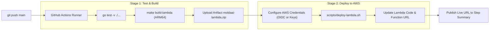

# 06 - Compilation and AWS Lambda Deployment Guide

This guide details the complete operational lifecycle: local development, testing, cross-compilation, and production deployment to **AWS Lambda** leveraging the ARM64 Graviton architecture and **Lambda Function URLs**.

---

## 1. Local Development and Execution

### Prerequisites
* Go 1.22+ installed (`go version`).
* Standard `zip` utility (installed by default on macOS and Linux).

### Automation Commands (`Makefile`)

From inside `app/` (or the project root):

```bash
# Run local HTTP Gin server on port :8080
make run

# Run comprehensive automated test suite
make test

# Build executable binary for current host OS
make build-local

# Build production ZIP package for AWS Lambda (Linux ARM64 Graviton)
make build-lambda

# Clean up build artifacts and binaries
make clean
```

After running `make run`, navigate in your browser to:
👉 **`http://localhost:8080`**

---

## 2. Compiling for AWS Lambda (ARM64 Graviton)

AWS Lambda offers the **ARM64 (Graviton)** architecture, which is ~20% more cost-effective and significantly faster than x86_64 for compiled Go workloads.

The `make build-lambda` recipe executes:

```bash
GOOS=linux GOARCH=arm64 CGO_ENABLED=0 go build -tags lambda.norpc -ldflags="-s -w" -o bootstrap main.go
zip moldaai-lambda.zip bootstrap
rm bootstrap
```

### Compiler Flags Breakdown:
* `GOOS=linux GOARCH=arm64`: Cross-compiles for Linux 64-bit ARM processors.
* `CGO_ENABLED=0`: Guarantees a fully statically linked Go binary without dynamic dependencies on C libraries (`glibc`).
* `-tags lambda.norpc`: Excludes legacy Lambda RPC boilerplate, trimming binary size and accelerating cold starts.
* `-ldflags="-s -w"`: Strips debug symbol tables and DWARF data, reducing the `bootstrap` executable from ~22MB to ~7.5MB (and ~3.8MB zipped).

---

## 3. Deploying to AWS Lambda

MoldaAí uses **Lambda Function URLs** (Payload Format v2.0), avoiding the operational complexity and billable costs of Amazon API Gateway.

### AWS Management Console Steps:

1. **Create Function:**
   * Open the AWS Lambda console &rarr; *Create function*.
   * Select **Author from scratch**.
   * Function name: `molda-ai-prod`.
   * Runtime: **Amazon Linux 2023** (`provided.al2023`).
   * Architecture: **arm64**.
2. **Enable Function URL:**
   * Under *Advanced settings*, check **Enable function URL**.
   * Auth type: **NONE** (public endpoint).
   * Enable **Configure cross-origin resource sharing (CORS)** if cross-domain integration is needed.
3. **Upload Deployment Package:**
   * In the function overview &rarr; *Code* tab.
   * Click *Upload from* &rarr; *.zip file*.
   * Select `moldaai-lambda.zip` produced by `make build-lambda`.
4. **Configure Memory & Timeout:**
   * Navigate to *Configuration* &rarr; *General configuration* &rarr; *Edit*:
     * **Memory:** `512 MB` or `1024 MB` (provides proportionate vCPU burst capacity, completing mesh calculations in < 40ms).
     * **Timeout:** `10 seconds` (generations average < 50ms; 10s provides ample safety buffer).

---

### Deployment via AWS CLI:

```bash
# 1. Compile the deployment package
make build-lambda

# 2. Create the execution IAM role (if not existing)
aws iam create-role \
  --role-name lambda-moldaai-role \
  --assume-role-policy-document '{"Version":"2012-10-17","Statement":[{"Effect":"Allow","Principal":{"Service":"lambda.amazonaws.com"},"Action":"sts:AssumeRole"}]}'

aws iam attach-role-policy \
  --role-name lambda-moldaai-role \
  --policy-arn arn:aws:iam::aws:policy/service-role/AWSLambdaBasicExecutionRole

# 3. Create the Lambda function (replace ACCOUNT_ID)
aws lambda create-function \
  --function-name molda-ai \
  --runtime provided.al2023 \
  --architectures arm64 \
  --role arn:aws:iam::ACCOUNT_ID:role/lambda-moldaai-role \
  --handler bootstrap \
  --zip-file fileb://moldaai-lambda.zip \
  --memory-size 512 \
  --timeout 10

# 4. Create the public Function URL
aws lambda create-function-url-config \
  --function-name molda-ai \
  --auth-type NONE

# 5. Grant public invoke permissions
aws lambda add-permission \
  --function-name molda-ai \
  --action lambda:InvokeFunctionUrl \
  --principal "*" \
  --function-url-auth-type NONE \
  --statement-id FunctionURLAllowPublicAccess
```

The command returns the public HTTPS Function URL, e.g.:
`https://a1b2c3d4e5f6g7h8.lambda-url.us-east-1.on.aws/`

Opening this URL serves the complete embedded SPA and API immediately.

---

## 4. Automated CI/CD Pipeline (GitHub Actions)

The repository includes a turnkey GitHub Actions workflow at [`.github/workflows/deploy.yml`](../.github/workflows/deploy.yml) that automatically tests, builds, and deploys to AWS Lambda on every push to `main` or via manual trigger (`workflow_dispatch`).



### GitHub Secrets & Variables Setup:
Under your GitHub repository &rarr; **Settings** &rarr; **Secrets and variables** &rarr; **Actions**:

#### Option A: OpenID Connect (OIDC — Recommended / No Long-Lived Keys):
* `AWS_ROLE_TO_ASSUME` (Secret): IAM Role ARN with GitHub OIDC trust relationship (e.g. `arn:aws:iam::123456789012:role/github-actions-moldaai-role`).
* `AWS_REGION` (Variable or Secret): e.g. `us-east-1`.
* `LAMBDA_FUNCTION_NAME` (Variable or Secret, optional): Defaults to `molda-ai`.

#### Option B: Standard IAM Credentials:
* `AWS_ACCESS_KEY_ID` (Secret): Access key for deploying IAM user.
* `AWS_SECRET_ACCESS_KEY` (Secret): Secret key for deploying IAM user.
* `AWS_REGION` (Variable or Secret): e.g. `us-east-1`.

---

## 5. Automated Deployment Script (`make deploy-lambda`)

You can also trigger a complete deployment from your local terminal using the configured script [`scripts/deploy-lambda.sh`](../scripts/deploy-lambda.sh):

```bash
# Deploys using active local AWS credentials
make deploy-lambda

# Or with custom parameters:
LAMBDA_FUNCTION_NAME=molda-ai-custom AWS_REGION=sa-east-1 make deploy-lambda
```

The script automatically:
1. Compiles the ARM64 bootstrap package if not already built.
2. Checks if the Lambda function and IAM role exist.
3. Provisions missing resources if deploying for the first time.
4. Updates existing function code, memory, and timeout settings.
5. Ensures public Function URL and CORS configurations are active.
6. Returns the live HTTPS endpoint directly in the terminal output.

---

## 6. Cost and Sizing Analysis

| Metric | Estimate for 100,000 Invocations / Month |
| :--- | :--- |
| **Average Execution Time** | ~45 milliseconds per generation |
| **Memory Allocation** | 512 MB (Graviton ARM64) |
| **AWS Lambda Compute Cost** | **$0.00** (Covered by AWS Permanent Free Tier: 1M free requests / month) |
| **Storage Cost (S3 / DB)** | **$0.00** (Zero database, zero disk or bucket usage) |
| **Data Transfer Out** | < $0.15 for Gzip-compressed binary STL payloads |
