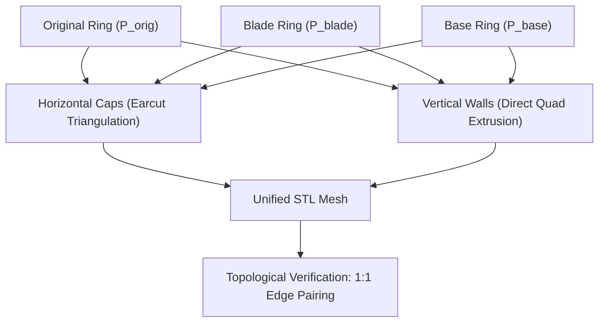

# 07 - Quality Assurance, Testing and Manifold Verification

The geometric integrity of an STL generator is measured by its ability to reliably produce **100% watertight 2-manifold** geometries free of holes, inverted normals, self-intersections, and open boundaries.

---

## 1. The Non-Manifold Problem in Additive Manufacturing

An STL file is an unindexed list of triangles in 3D Euclidean space. If adjacent triangles do not share identical vertex coordinates, or if an edge belongs to only one triangle (open boundary) or more than two triangles (non-manifold edge), severe slicing artifacts occur:
* Slicers (Cura, PrusaSlicer, Bambu Studio) fail to reliably determine solid interior vs exterior void.
* Layers may be omitted, producing weak or disconnected prints.
* Heuristic auto-repair routines can introduce distortions to fine cutting contours.

---

## 2. MoldaAí's Correct-by-Construction Architecture

MoldaAí avoids heuristic post-processing repairs by constructing the mesh **correct by construction**:



### Directed Edge-Pairing Invariant:
For every triangular facet with ordered vertices $(V_1 \to V_2 \to V_3)$:
1. There exist 3 directed edges: $(V_1 \to V_2)$, $(V_2 \to V_3)$, and $(V_3 \to V_1)$.
2. In a closed 2-manifold surface, for every directed edge $(A \to B)$, there must exist **exactly one** oppositely directed edge $(B \to A)$ belonging to an adjacent triangle.
3. If $\text{count}(A \to B) = \text{count}(B \to A)$ for every edge across the entire STL file, the mesh is provably watertight and closed with zero boundary openings.

---

## 3. Automated Watertight Manifold Verification Test

The unit test file `app/internal/generator/generator_test.go` enforces this topological verification programmatically:

```go
func TestMeshWatertightManifold(t *testing.T) {
    // 1. Generate complete STL model from test silhouette
    stlBytes, err := GenerateSTL(bytes.NewReader(pngData), params)
    if err != nil {
        t.Fatalf("GenerateSTL failed: %v", err)
    }

    // 2. Parse binary facets and track directed edges (v1 -> v2)
    // 3. Verify exact 1:1 pairing with opposite edges (v2 -> v1)
    unmatched := 0
    for e, count := range directedEdges {
        opp := edgeKey{e.x2, e.y2, e.z2, e.x1, e.y1, e.z1}
        if count != directedEdges[opp] {
            unmatched++
        }
    }

    // If unmatched == 0: 100% watertight manifold guaranteed!
}
```

### Test Output Verification:
```text
=== RUN   TestMeshWatertightManifold
    generator_test.go:216: Mesh verified: 100% watertight manifold, 960 facets, 0 open edges!
--- PASS: TestMeshWatertightManifold (0.00s)
```

---

## 4. Test Suite Coverage

The test suite validates every layer of the system:

### 4.1 `generator` Package Tests:
* `TestProcessImage`: PNG luminance decoding, threshold classification, and pixel edge checks.
* `TestExtractVectorContours`: Contour loop extraction and area hierarchy validation ($\text{Area}(\text{Base}) > \text{Area}(\text{Blade}) > \text{Area}(\text{Original})$).
* `TestGenerateSTLComplete`: Header byte verification and facet count byte length checks ($84 + N \times 50$ bytes).
* `TestMeshWatertightManifold`: Formal directed edge-pairing topological closure test.
* `TestValidationErrors`: Error handling when invalid dimensions are provided (e.g. `base_height >= blade_height`).
* `TestLetterAWithHoleAndSmoothing`: Validates complex multi-loop geometry containing internal negative space and structural bridging.
* `TestProcessSVGImage`: Validates vector SVG parsing, rasterization, and mesh generation.

### 4.2 `api` Package Tests:
* `TestGenerateSTLHandlerSuccess`: End-to-end `multipart/form-data` POST request with Gzip negotiation and decompression.
* `TestGenerateSTLHandlerMissingImage`: Returns `400 Bad Request` when `image` is missing.
* `TestGenerateSTLHandlerInvalidParams`: Returns `400 Bad Request` when parameters violate geometric bounds.

---

## 5. Running the Tests

```bash
cd app
go test -v ./...
```
Execution duration: **under 1.0 second** for the complete suite.
